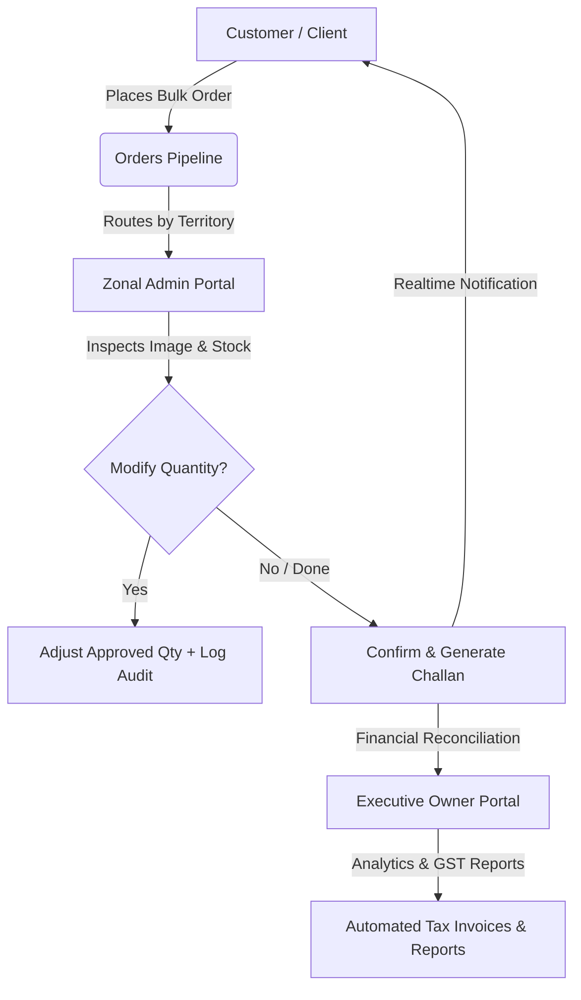

<div align="center">

# 🏢 AK Enterprises — Enterprise B2B E-Commerce & Supply Chain Portal

<p align="center">
  <strong>Next-Generation Wholesale Ordering, Realtime Multi-Tier Distribution & Intelligent Supply Chain Management Platform</strong>
</p>

[](https://nextjs.org/)
[](https://reactjs.org/)
[](https://supabase.com/)
[](https://tailwindcss.com/)
[](#)
[](https://github.com/ayanshaikh29)

<br/>

[🌟 Key Features](#-key-features) •
[🏛️ Architecture](#-portal-architecture) •
[💻 Tech Stack](#-tech-stack) •
[🚀 Getting Started](#-getting-started) •
[🗄️ Database Schema](#-database--supabase-setup) •
[👨‍💻 Author](#-crafted-with--by)

---

</div>

<br/>

## 🎯 Overview

**AK Enterprises** is a full-featured, enterprise-grade B2B e-commerce platform built for high-volume wholesale operations, corporate procurement, and multi-zone distribution. It connects business customers, regional zonal administrators, and corporate leadership under one unified, real-time operating ecosystem.

From dynamic customer-specific tiered pricing to automated GST tax invoicing, delivery challan generation, and granular order quantity approvals, this system streamlines the complete wholesale lifecycle.

---

## ✨ Key Features

### 🛒 1. Customer Wholesale Storefront
- 🏷️ **Tiered B2B Pricing**: Automatically calculates wholesale discounts, minimum order quantities (MOQ), and customer-specific contractual rates.
- ⚡ **Instant Quoting & Cart System**: Live bulk quotes, dynamic cart tax computation (CGST / SGST / IGST based on billing vs. shipping states).
- 📦 **Order Tracking & History**: Real-time status milestones (`Pending` ➔ `Confirmed` ➔ `Shipped` ➔ `Delivered`).
- 📄 **One-Click Invoice & Challan Downloads**: Direct PDF generation for tax invoices and dispatch challans.
- 💬 **Live Support & WhatsApp Ordering**: Integrated chatbot and WhatsApp direct-order messaging.

### 🛡️ 2. Zonal Admin (Vendor) Management Portal
- 🔑 **Dual Authentication**: Secure login via **Username** (e.g. `zonal_admin_mumbai`) or **Email**.
- 🖼️ **Visual Order Inspection**: High-resolution product thumbnails and specifications displayed directly on every pending order line.
- ✏️ **Granular Quantity Adjustment**: Zonal admins can modify requested quantities before order confirmation based on actual warehouse stock.
- 🔒 **Zero Data Overwriting**: Preserves `original_quantity` permanently alongside `approved_quantity` with a full audit log in `order_quantity_modifications`.
- 🚚 **Dispatch & Challan Management**: Set transport details, vehicle numbers, and generate delivery challans instantly.

### 👑 3. Executive Owner & Admin Suite
- 📊 **Executive Analytics Dashboard**: Live metrics for revenue, active orders, customer acquisition, and low-stock alerts.
- 👥 **Customer & Zonal Admin Management**: Create and assign Zonal Admins, configure credit lines, and set custom price tiers.
- 📈 **Financial & GST Reports**: Generate audit-ready Excel reports (`Order Details`, `Products Sold`, `Tax Summaries`) compliant with Indian GST laws.
- 🎨 **Dynamic Storefront CMS**: Update marquees, banners, hero sections, and client portfolios in real time without code deployment.

---

## 🏛️ Portal Architecture



---

## 💻 Tech Stack

| Domain | Technology / Library | Description |
| :--- | :--- | :--- |
| **Frontend Framework** | **Next.js 15 (App Router)** | Hybrid SSR & React Server Components with Turbopack |
| **UI Library** | **React 19** | Dynamic, concurrent UI with hydration safety |
| **Styling** | **Tailwind CSS** | Premium custom design system with maroon & gold gradients |
| **Icons** | **Lucide React** | Lightweight, modern icon set |
| **Backend & API** | **Next.js Edge/Node Route Handlers** | High-performance RESTful APIs with route grouping |
| **Database & Auth** | **Supabase (PostgreSQL 15)** | Row Level Security (RLS), real-time listeners & indexing |
| **Email Service** | **Resend API** | Transactional dispatch notices & invoice distribution |
| **Document Engine** | **HTML5 Canvas / PDFMake** | Instant client-side & server-side Tax Invoice and Challan PDFs |
| **Spreadsheets** | **ExcelJS** | Multi-tab institutional GST reconciliation workbooks |
| **Testing** | **Node Test Runner (`node --test`)** | 37 automated tests for GST logic, date filters & aggregation |

---

## 🚀 Getting Started

### 📋 Prerequisites
- **Node.js**: `v18.17.0` or higher
- **Package Manager**: `npm`, `yarn`, or `pnpm`
- **Supabase Account**: A Supabase project with PostgreSQL

### 📥 1. Clone the Repository
```bash
git clone https://github.com/ayanshaikh29/AK-Ecommerce.git
cd ak-enterprises-website
```

### 📦 2. Install Dependencies
```bash
npm install
```

### ⚙️ 3. Configure Environment Variables
Create a `.env` file in the root directory:
```env
NEXT_PUBLIC_SUPABASE_URL=https://your-project.supabase.co
NEXT_PUBLIC_SUPABASE_ANON_KEY=your-supabase-anon-key
SUPABASE_SERVICE_ROLE_KEY=your-supabase-service-role-key
RESEND_API_KEY=your-resend-api-key
NEXT_PUBLIC_APP_URL=http://localhost:3000
```

### 🗄️ 4. Apply Database Migrations
Run the consolidated SQL upgrade script in your **Supabase SQL Editor**:
```bash
# File located at:
supabase-master-upgrade.sql
```
*This enables username authentication, order quantity tracking columns, audit trail tables, and performance indexes.*

### 🧪 5. Run Test Suite
```bash
npm test
```
*Executes all 37 unit tests across GST tax calculation, revenue exclusion, and Excel aggregation.*

### ⚡ 6. Start Development Server
```bash
npm run dev
```
Open **[http://localhost:3000](http://localhost:3000)** in your browser to view the application.

---

## 🗄️ Database & Supabase Setup

The database is built on PostgreSQL via Supabase and includes:

```
├── users                         # Customer, Zonal Admin & Owner profiles (with unique username)
├── orders                        # Order header records with multi-status state machine
├── order_items                   # Order line items (original_quantity, approved_quantity)
├── order_quantity_modifications  # Immutable audit trail of every quantity change
├── products                      # Product catalog with HSN codes, GST %, and pricing
├── product_images                # Multi-image associations per SKU
├── custom_pricing                # Customer-specific and zone-specific negotiated pricing
├── delivery_challans             # Vehicle, transport, and dispatch records
└── site_settings                 # Dynamic CMS configuration
```

---

## 👨‍💻 Crafted with ❤️ by

<div align="center">
  
  <h3>Ayan Shaikh</h3>
  <p><strong>Full-Stack Engineer & Enterprise Solutions Architect</strong></p>

  <p>
    <a href="https://github.com/ayanshaikh29">
      
    </a>
    <a href="mailto:buildwithayan29@gmail.com">
      
    </a>
    <a href="https://digitaladvertise.in">
      
    </a>
  </p>
</div>

---

<div align="center">
  <sub>© 2026 <strong>AK Enterprises</strong>. Designed & Developed by <strong>Ayan Shaikh</strong>. All rights reserved.</sub>
</div>
